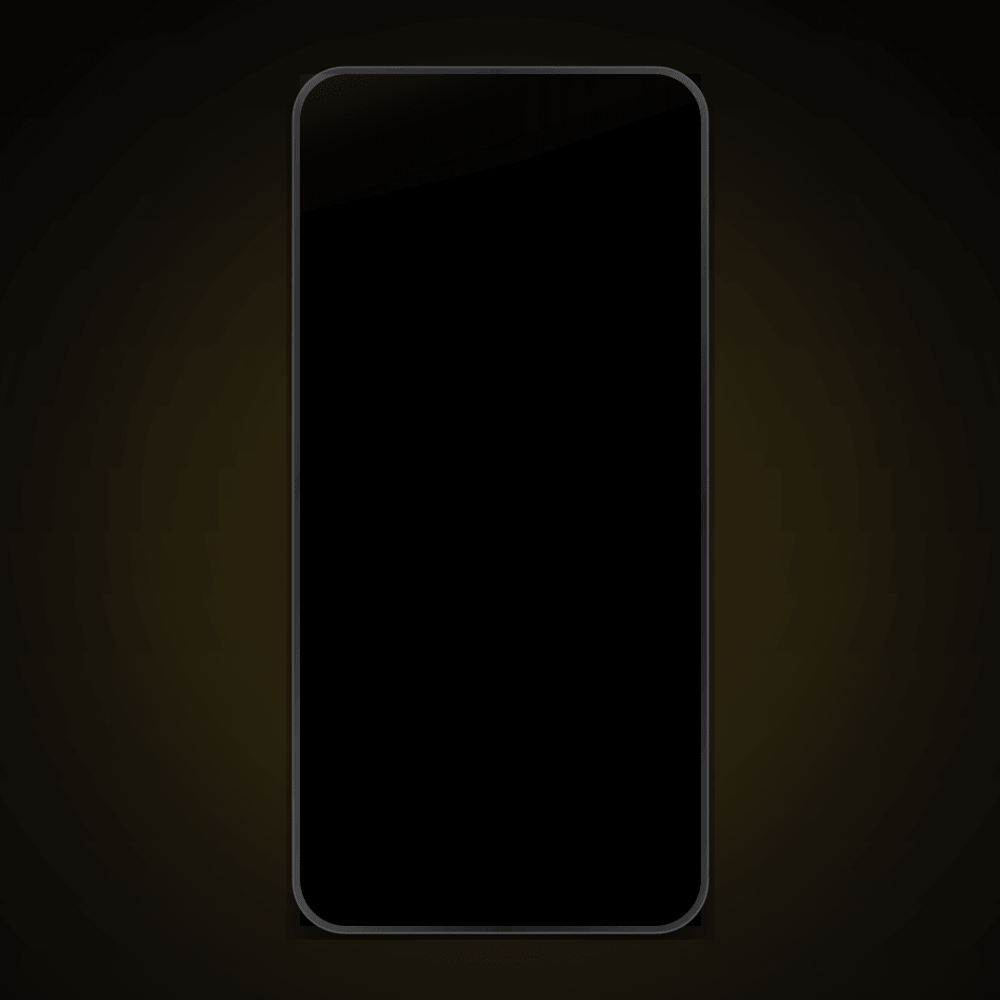

# Locko Notes — Official iOS Shortcuts Setup & Automation

> **Transform your daily to-do list, priorities, and aesthetic reminders into dynamic iPhone lock screen wallpapers with zero battery drain.**

  

🌐 **Live Web App & Wallpaper Designer**: [lockonotes.com](https://lockonotes.com)  
📲 **1-Tap Official iOS Shortcut**: [Install via iCloud](https://www.icloud.com/shortcuts/eb836a3b59b640db979e33ad7602d4fd)

---

## ⚡ What is Locko Notes?

Most to-do apps require you to unlock your phone, find an app icon, and navigate an interface—which triggers immediate distraction from incoming social media notifications.

**Locko Notes** solves this by burning your daily focus note directly into an obsidian OLED true black (`#000000`) or frosted glass lock screen wallpaper tailored to your exact device pixel dimensions.

Through Apple's native **iOS Shortcuts** and **Personal Automations**, your lock screen wallpaper automatically refreshes in the background (e.g. every morning at 7:00 AM or whenever you edit your notes) with **0% battery drain**.

---

## 🚀 Quick Setup (3 Minutes)

### Step 1: Design Your Wallpaper
1. Visit [lockonotes.com](https://lockonotes.com) on your iPhone Safari or desktop.
2. Select your device model (supports iPhone SE up to iPhone 17 Pro Max & iPads).
3. Choose your theme:
   - **Pure AMOLED Obsidian** (`#000000`) — zero eye strain, battery-efficient.
   - **Locket Squircle / Polaroid** — photo frames, romantic drops, or selfie checks.
   - **Frosted Glass Bento** — subtle specular borders and Apple typography (`SF Pro` / `Outfit`).
4. Tap **Download Wallpaper** to test it instantly, or **Login to Sync** to get your private sync URL.

### Step 2: Install the Official iOS Shortcut
1. Tap the official iCloud link: **[Install Locko Notes Shortcut](https://www.icloud.com/shortcuts/eb836a3b59b640db979e33ad7602d4fd)**.
2. Tap **Add Shortcut** in your Shortcuts app.
3. When prompted, paste your private Locko Notes URL or code.

### Step 3: Enable Background Automation
1. Open the **Shortcuts** app on your iPhone $\rightarrow$ select the **Automation** tab at the bottom.
2. Tap **New Automation** (or the `+` button in the top right).
3. Choose **Time of Day** (e.g. `7:00 AM`, repeat `Daily`).
4. Select **Run Immediately** (toggle off *Notify When Run* so it refreshes silently).
5. Choose **Locko Notes** as the action.

Done! Every morning your iPhone will wake up with your updated priorities and aesthetic lock screen.

---

## 📱 Features

- **Apple HIG Design System**: G2 continuous squircle curvature, SF Pro typography, and specular glassmorphism.
- **Zero Battery Consumption**: Uses native static image rendering via Apple Shortcuts rather than persistent background GPS or widget services.
- **Couple & Bestie Note Drops**: Pair with a partner using a private 6-character code. Surprise your favorite person by dropping live love notes or inside jokes right onto their lock screen.
- **Privacy First**: End-to-end HTTPS encrypted sync via Supabase storage.

---

## 🛠 Supported Devices

- iPhone 17 / 17 Pro / 17 Pro Max / 17 Air / 17e
- iPhone 16 / 16 Pro / 16 Pro Max / 16 Plus
- iPhone 15 / 15 Pro / 15 Pro Max / 15 Plus
- iPhone 14 / 14 Pro / 14 Pro Max / 14 Plus
- iPhone 13 / 13 Pro / 13 Pro Max / 13 mini
- iPhone 12 / 12 Pro / 12 Pro Max / 12 mini
- iPhone 11 / 11 Pro / 11 Pro Max / XR / X / XS
- iPad Pro / iPad Air / iPad mini (All generations)

---

## 📄 License

MIT License. Designed and maintained for the Apple iOS productivity community.
Visit [lockonotes.com](https://lockonotes.com) to get started.
